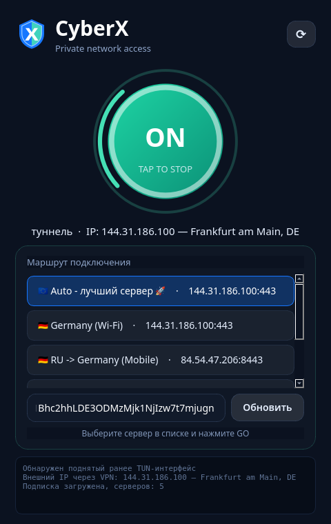

# CyberX VPN — Desktop (Debian)

Десктопный VPN-клиент под Debian/GNOME. Полный TUN-режим: весь трафик машины
идёт через туннель (sing-box, VLESS + Reality). UI повторяет Android-клиент
[CyberX-android-VPN](https://github.com/miazigoo/CyberX-android-VPN).



## Возможности

- Загрузка серверов из ссылки подписки (vless://, base64).
- Полный VPN (TUN, интерфейс `cyberx0`): auto_route, DNS → DoH поверх туннеля,
  приватные сети (LAN, docker-мосты) исключены из маршрутизации.
- Root-операции — через `pkexec helper.sh` (polkit-запрос пароля).
- Тёмная фирменная тема, круглая анимированная кнопка GO/ON.

## Структура

```
cyberx_vpn/            # пакет приложения
├── subscription.py    # загрузка подписки, парсинг vless://
├── configgen.py       # генерация конфига sing-box
├── tunnel.py          # TunManager — управление TUN через pkexec
├── netcheck.py        # проверка внешнего IP через туннель
├── app.py             # точка входа (QApplication)
└── ui/
    ├── main_window.py # главное окно
    ├── connect_button.py  # круглая кнопка GO/ON
    ├── style.py       # QSS-тема
    └── worker.py      # фоновые потоки
main.py                # лаунчер из исходников
helper.sh              # root-хелпер (up/down/status), вызывается через pkexec
tools/fetch_singbox.sh # скачивание sing-box (не хранится в git)
tests/                 # pytest, ядро без GUI
assets/                # иконка-щит (svg + png)
```

## Разработка

```bash
python3 -m venv .venv
.venv/bin/pip install PySide6 ruff pre-commit pytest pyinstaller
./tools/fetch_singbox.sh          # скачать движок sing-box
.venv/bin/pre-commit install      # хуки в git
```

Проверки перед коммитом (pre-commit прогонит их сам):

```bash
.venv/bin/ruff check --fix .
.venv/bin/ruff format .
.venv/bin/pytest
.venv/bin/pre-commit run --all-files
```

Запуск из исходников:

```bash
./run.sh
```

## Сборка и установка

```bash
.venv/bin/pyinstaller --noconfirm cyberx-vpn.spec
cd dist/cyberx-vpn && cp -r _internal/helper.sh _internal/sing-box _internal/assets . && chmod +x helper.sh sing-box
cp -r dist/cyberx-vpn ~/apps/cyberx-vpn
```

Ярлык в меню приложений: `~/.local/share/applications/cyberx-vpn.desktop`,
иконка: `~/.local/share/icons/hicolor/256x256/apps/cyberx-vpn.png`.

## Аварийный сброс

Если приложение закрылось, а туннель остался:

```bash
pkexec ~/apps/cyberx-vpn/helper.sh down
```

Это остановит sing-box, удалит маршруты и вернёт `/etc/resolv.conf` из бэкапа.
